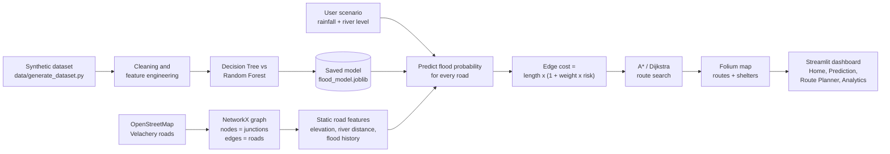

# FloodGuard Lite

**AI-based flood evacuation route planner** (Artificial Intelligence course project)

FloodGuard Lite is a small, fully local prototype. A supervised machine-learning
model predicts how likely every road in a neighbourhood is to flood, and a graph
search algorithm (A\* or Dijkstra) then finds the evacuation route that best
balances **short distance** against **low flood risk**. The result is shown on an
interactive map inside a four-page Streamlit app.

> **Scope.** This is a proof of concept for learning, not a disaster-management
> system. It simulates one small area (Velachery, Chennai), uses no live data,
> and runs entirely on your own computer.

## What it demonstrates

| AI concept | Where |
|---|---|
| Supervised learning (Decision Tree vs Random Forest) | `models/train_model.py` |
| Feature engineering, evaluation, confusion matrix | `utils/features.py`, `reports/` |
| Graph representation of a road network | `routing/graph_builder.py` |
| Search algorithms (Dijkstra and A\*) and cost design | `routing/algorithms.py`, `routing/cost.py` |
| Decision making under risk | `routing/shelters.py` |
| Interactive visualisation | `dashboard/map_builder.py`, `dashboard/streamlit_app.py` |

## How it works



1. **Predict.** For each road the model estimates a flood probability (0.0 to 1.0)
   from rainfall, river level, elevation, distance from the river, historical
   flood frequency and road type.
2. **Weigh.** Each road gets a cost that grows with its flood risk:
   `cost = length x (1 + weight x risk)`. With `weight = 0` this is plain
   distance; a larger weight makes the planner avoid risky roads more strongly.
   (The additive form `length + weight x risk` is also available in
   `routing/cost.py`.)
3. **Search.** A\* finds the least-cost route. A straight-line-distance heuristic
   never overestimates, because every road costs at least its length, so A\*
   returns the same optimal cost as Dijkstra while visiting fewer nodes.
4. **Show.** The map draws roads green (safe, below 30 %), yellow (moderate) and
   red (flooded, 70 % or more), the recommended route in blue, the plain
   shortest route as a grey dashed line, and purple markers for shelters.

## Installation

Requirements: **Python 3.10 or newer** (tested on 3.12) and an internet
connection for the first run (the road network is downloaded once and cached).

```bash
# 1. Get the code
git clone https://github.com/Kazxd/FloodGuard-AI.git
cd FloodGuard-AI

# 2. Create and activate a virtual environment
python -m venv .venv
.venv\Scripts\Activate.ps1          # Windows PowerShell
# source .venv/bin/activate         # macOS / Linux

# 3. Install the libraries
pip install -r requirements.txt     # or requirements-lock.txt for the exact tested versions
```

## Usage

```bash
# 1. Generate the dataset          -> data/raw/road_segments.csv
python -m data.generate_dataset

# 2. Train and evaluate the models -> models/flood_model.joblib, reports/metrics.json, reports/figures/
python -m models.train_model

# 3. Launch the dashboard
streamlit run main.py
```

Optional: `python -m dashboard.map_builder` writes a standalone demo map to
`reports/demo_map.html`.

### The four dashboard pages

| Page | What you do |
|---|---|
| **Home** | Read the project overview and architecture. |
| **Flood Prediction** | Enter rainfall, river level and road details, then click *Predict Flood* to see the flood probability. |
| **Route Planner** | Set rainfall, river level and the flood weight, choose a start and a destination (or the nearest shelter), then click *Compute Route*. |
| **Analytics** | See model accuracy, precision, recall, F1, confusion matrices and the Dijkstra vs A\* comparison. |

## Dataset

No public dataset has flood labels for individual roads with these features, so
`data/generate_dataset.py` creates a **synthetic** one of 6,000 road/weather
samples. Flood labels are drawn from a documented logistic equation (rainfall,
river level near the river, flood history, low elevation and road type, plus
random noise for unobserved factors such as blocked drains).

Because the labels are random draws, even a perfect model cannot reach 100 %.
The file keeps the true probability in a `true_probability` column so the best
achievable score is known; it is **never** given to the model as a feature.
The machine-learning task therefore measures how well a model *learns this
risk pattern*, not real-world flood accuracy.

## Results

Seed 42, 80/20 stratified split (1,200 test rows), scikit-learn 1.9.1:

| Model | Accuracy | Precision | Recall | F1 | ROC AUC |
|---|---|---|---|---|---|
| Decision Tree | 0.743 | 0.660 | 0.543 | 0.596 | 0.782 |
| **Random Forest** (selected) | **0.754** | 0.702 | 0.512 | 0.592 | **0.798** |
| *Best possible (knows the true probability)* | *0.769* | | | *0.625* | *0.841* |

The Random Forest reaches about 95 % of the best possible ROC AUC. It is selected by
ROC AUC because the router uses probabilities, not yes/no labels. Recall is
modest at the default 0.5 threshold; this is partly built into the noisy labels
(even the best possible model scores only about 0.62 F1 there).
Your own numbers are saved in `reports/metrics.json` after training and shown on
the Analytics page.

## Testing

```bash
python -m unittest discover -s tests -t . -v
```

The tests cover data generation, cleaning, feature engineering, model
evaluation, graph building, the cost function, Dijkstra/A\* (including the
property that both return the same optimal cost), shelters, risk assignment,
map output and every dashboard page (using Streamlit's headless `AppTest`).
Tests that need the trained model are skipped until you run step 2 above.

For a style check and coverage, install the extras and run:

```bash
pip install -r requirements-dev.txt
flake8 --max-line-length 110 .
coverage run -m unittest discover -s tests -t . && coverage report
```

## Project structure

```
FloodGuard-AI/
├── data/
│   ├── generate_dataset.py     synthetic dataset generator
│   ├── raw/                    generated CSV
│   └── processed/              cached road-network graph
├── models/
│   └── train_model.py          cleaning, tuning, evaluation, saving
├── routing/
│   ├── graph_builder.py        OSM road graph and static road features
│   ├── risk.py                 ML flood probability for every road
│   ├── cost.py                 distance + flood-risk edge cost
│   ├── algorithms.py           Dijkstra, A*, benchmark helper
│   └── shelters.py             shelter selection and nearest-shelter routing
├── dashboard/
│   ├── map_builder.py          Folium map
│   └── streamlit_app.py        the four Streamlit pages
├── utils/
│   ├── config.py               every path, range and constant in one place
│   └── features.py             feature engineering shared by training and prediction
├── tests/                      unit, property and dashboard tests
├── reports/                    metrics.json, figures, demo map
├── main.py                     entry point: streamlit run main.py
├── requirements.txt            runtime libraries (ranges)
├── requirements-lock.txt       exact tested versions
└── requirements-dev.txt        test and style tools
```

## Limitations

- **Synthetic labels.** Results show learnability of a known rule, not real flood prediction.
- **Synthetic terrain features.** Elevation and flood history are generated, not read from a
  digital elevation model or flood records.
- **Straight road segments.** Roads are drawn as straight lines between junctions.
- **Scenario inputs.** In training, river level rises with rainfall; the dashboard lets you set
  them independently, so extreme combinations are extrapolations.
- **One small area, no live data.** No weather feeds, sensors or traffic.

## Future scope

- Replace the synthetic data with real flood records and a digital elevation model.
- Use live rainfall and river-gauge feeds.
- Add traffic and road-closure information, and real shelters (schools, hospitals) from OpenStreetMap.
- Compare more models and tune the decision threshold for higher recall.
- Multi-objective routing (time, risk, capacity) and many-vehicle evacuation planning.
- Deploy to the cloud with a mobile-friendly interface.

## Troubleshooting

| Problem | Fix |
|---|---|
| PowerShell says scripts are disabled | Run `Set-ExecutionPolicy -Scope CurrentUser RemoteSigned`, then activate the environment again. |
| First route is slow or fails | The first run downloads the road network and needs internet. Without it, the app falls back to a synthetic grid. |
| `InconsistentVersionWarning` about scikit-learn | The saved model was trained with a different version. Run `python -m models.train_model` again. |
| "Model not found" message | Run steps 1 and 2 under *Usage* first. |
| Port already in use | `streamlit run main.py --server.port 8502` |

## Credits

Road-network data and map tiles: © OpenStreetMap contributors (ODbL).
Built with scikit-learn, NetworkX, OSMnx, Folium and Streamlit.